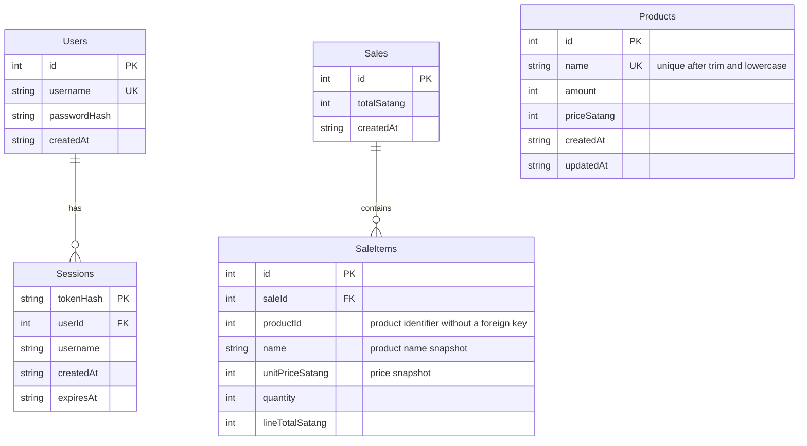

# Data Architecture & Persistence Layer

The backend stores five entities in SQLite using Drizzle ORM with the `better-sqlite3` driver. The schema covers user sessions, inventory products, and sales with line-item snapshots.

## Database Configuration

| Service/Module | DB Type | Profile | Driver | Connection | Migration Tool |
|---|---|---|---|---|---|
| Store Management backend | SQLite | Default; tests may use in-memory SQLite | better-sqlite3 | `DATABASE_URL`, defaulting to `./data/store.sqlite` | None; schema is created by SQL in `src/db/seed.ts` |

The Drizzle table definitions are in `server/src/db/schema.ts`. The seed script creates the tables and indexes transactionally and inserts the owner and starter products when absent. No separate migration framework or database profile configuration was found.

## Data Ownership per Service

| Service | Tables Owned | ORM Framework | Caching | Notes |
|---|---|---|---|---|
| Store Management backend | `users`, `sessions`, `products`, `sales`, `sale_items` | Drizzle ORM | None found | All modules use the same SQLite database. |

## Entity Model

Entity definitions are in [schema.ts](../../../../../server/src/db/schema.ts); the application creates SQLite connections in [index.ts](../../../../../server/src/db/index.ts).

<!-- mermaid-checked: every attribute is `<type> <name> [<key>] ["<description>"]` with at most one of PK/FK/UK, no \n in descriptions, no {} in descriptions, every relationship label is double-quoted -->

`sessions.user_id` references `users.id` and cascades on user deletion. `sale_items.sale_id` references `sales.id` and cascades on sale deletion. `sale_items.product_id` intentionally has no declared foreign key; the item also stores the product name and unit-price snapshots. Amounts and prices are integer satang values. Check constraints restrict product amount and price, nonnegative sale totals and item amounts, and positive item quantity.

Sources: [schema.ts](../../../../../server/src/db/schema.ts), [seed.ts](../../../../../server/src/db/seed.ts).

## Key Repository Methods

There are no dedicated repository interfaces; router modules query Drizzle directly.

| Service | Repository | Notable Methods | Purpose |
|---|---|---|---|
| Authentication | `router/auth.ts` and `middleware/session.ts` | Select user by username or ID; select session by token hash; insert and delete sessions | Authenticate accounts and resolve or revoke stored sessions. |
| Inventory | `router/product.ts` | Filter and count products; insert, update, and select products | Search and paginate products, and perform product writes. |
| Sales | `router/sale.ts` | Aggregate sale count and total by timestamp range; relational `sales.findMany` with items | Return a date-bounded summary and its sale-item records. |

Sources: [auth.ts](../../../../../server/src/router/auth.ts), [session.ts](../../../../../server/src/middleware/session.ts), [product.ts](../../../../../server/src/router/product.ts), [sale.ts](../../../../../server/src/router/sale.ts).

## Caching Strategy

No application-level or ORM query cache was found. The backend reads and writes directly through Drizzle and SQLite.

## Data Ownership Boundaries

All five tables reside in one SQLite database owned by the Store Management backend. Authentication and inventory/sales code are modules within that backend, not separate services or isolated stores. Modules access the same database through Drizzle; no cross-service database access or remote aggregation was found. Sale items preserve the product name and unit price at the time of sale and do not enforce a foreign-key relationship to the current product row.

### Data Classification & Sensitivity

| Entity | Sensitive Fields | Classification (PII/PHI/PCI/None) | Controls in Place |
|---|---|---|---|
| Users | `username`, `password_hash` | PII and authentication credential | Passwords are bcrypt-hashed. No database encryption-at-rest or username masking was found. |
| Sessions | `user_id`, `username`, `token_hash` | PII and authentication data | Session IDs are hashed before storage. No database encryption-at-rest or field masking was found. |
| Products | None identified | None | No specific controls found or needed for the listed product fields. |
| Sales | None identified | None | No customer or payment-card fields found. |
| Sale items | None identified | None | Product and price snapshots only; no customer or payment-card fields found. |
